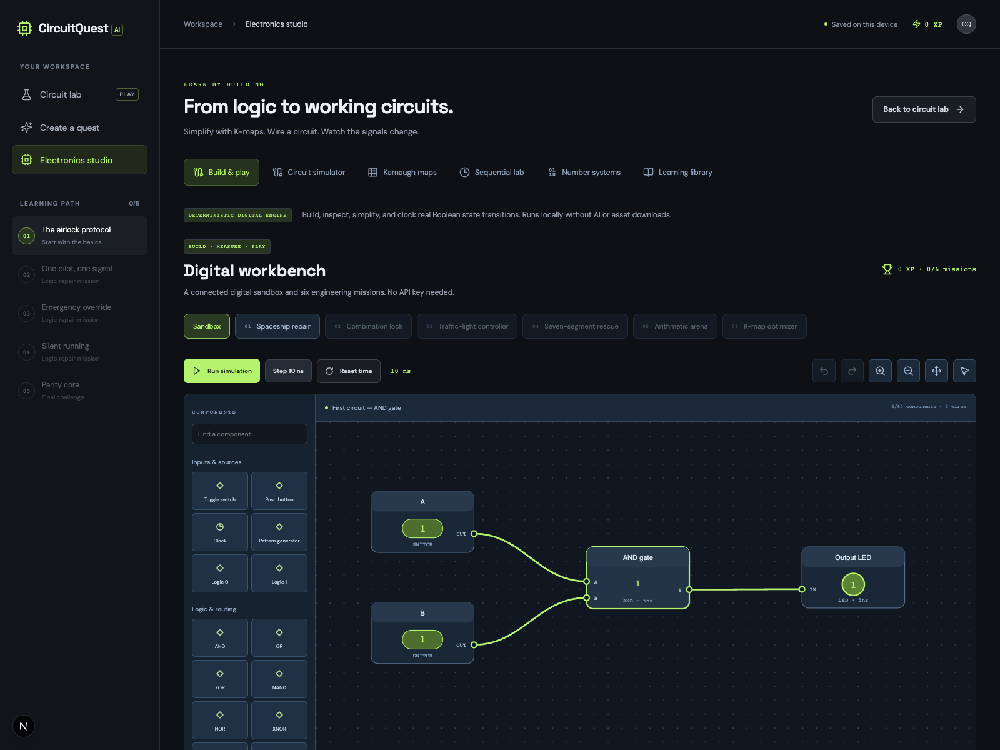

# CircuitQuest AI

**Turn digital electronics problems into playable circuit repair missions, then build circuits, measure signals, and solve engineering missions.**

Built for Hacktoberfest Hack Day, October 31, 2026. Next.js + TypeScript, React, Zod, and Google's `@google/genai` SDK. MIT licensed application code. Gemma model weights and the hosted API have their own terms.



## Run locally

Requires **Node.js 22.12+** and npm.

```sh
npm ci
cp .env.example .env.local
npm run dev
```

Open http://localhost:3000. No account or API key is required for the five-mission campaign, the complete Electronics studio, or the explicitly labeled demo fallback.

For real inference, put your Google AI Studio Gemini API key in `.env.local`:

```dotenv
GEMINI_API_KEY=your_key_here
GEMMA_MODEL=gemma-4-26b-a4b-it
```

Restart the server after changing environment variables. Keep this key server-side. Never use a `NEXT_PUBLIC_` key, commit `.env.local`, or paste a key into the browser. The lockfile pins the tested dependency versions.

[Google's Gemma on Gemini API documentation](https://ai.google.dev/gemma/docs/core/gemma_on_gemini_api) lists `gemma-4-26b-a4b-it` and `gemma-4-31b-it`. Availability, quotas, and image support depend on the selected model and your API account. This app requests plain JSON and validates it locally rather than assuming Gemma supports Gemini's structured-output configuration.

## Play

1. Start in Circuit lab. Read the mission's intended behavior.
2. Toggle A/B/C to inspect live signals. Select a gate, then replace its operation using the gate palette. Wiring stays fixed.
3. Click **Verify circuit**. Every one of the 4 or 8 input combinations is evaluated; mismatches are highlighted in the truth table.
4. Use up to three progressively revealing hints. Your first successful campaign clear awards `max(25, 150 − 15 × failed verifications − 25 × hints)` XP. Replaying a cleared mission awards no more XP.
5. Clear all five missions to finish the campaign. Progress, current circuit, hints, attempts and XP save in this browser's local storage. Reset progress is available in the desktop sidebar. Local saves are not accounts or tamper-proof leaderboards.

## Create a quest

Open **Create a quest** / **Upload a problem**, enter text and/or upload a JPG/PNG (up to 3 MB), then generate. Printed and handwritten problems use the same image inference path. Review the interpreted description and confirm it before starting. Revise the input if the interpretation differs from your source. AI interpretation can be wrong even when the circuit is structurally valid.

Supported: a single combinational Boolean problem, 2–3 unique variables from A/B/C, 1–6 gates, one output, AND/OR/XOR/NAND/NOR/XNOR/NOT/BUFFER. Unary slots permit NOT or BUFFER; binary slots permit the six binary operations. Every node must feed the output. Cycles, undefined references, duplicate IDs, invalid arity, unused gates and extra properties are rejected. No code evaluation is used. Equivalent circuits are accepted by their exhaustive output behavior.

A printable image is included at [`public/sample-problem.png`](public/sample-problem.png). With the app running, open `/sample-problem.png`, save it, then upload it from Create a quest.

Example inputs:

- “Output is high when both A and B are high.”
- “Output is (A XOR B) AND C.”
- “An alarm activates when neither A nor B is active.”

The AI repair game remains intentionally limited to small, verifiable Boolean challenges. It does not convert an entire syllabus or interpret arbitrary electronics schematics. The separate Electronics studio provides editable wiring and ideal sequential simulations as described below.

## Electronics studio

Open **Electronics studio** in the sidebar (also available on mobile). Everything in this workspace runs locally and deterministically; it does not call an AI model.

### Build & play — advanced digital workbench

This is the default Electronics studio tab. Start with a working AND circuit, or choose **New blank board**.

- Drag components from the palette onto the canvas, or click to place them. Drag component headers to move them on a 20-unit grid. Rotate, duplicate, delete, undo/redo, zoom, pan, and fit the board. Mobile users can tap the palette and wire with the selectors.
- Connect an **output pin first, then an input pin**. The Wiring & probes panel also offers explicit source/target selectors and wire removal. Multiple drivers are allowed; incompatible bit widths and invalid pins are rejected.
- Components: switches, momentary buttons, clocks, pattern generators, constant sources, all eight Boolean gate operations, tri-state buffers, LEDs, probes, seven-segment displays, muxes, decoders, D/T/JK flip-flops, four-bit registers/counters, 4×4-bit ROM/RAM, bus packers/splitters and reusable combinational blocks.
- Runtime: 0/1 plus **X** (unknown/conflict) and **Z** (floating/high impedance), four-bit bus values, configurable 0–100 ns inertial gate delays, asynchronous reset, and positive-edge sequential state updates. Delays suppress pulses shorter than the configured delay. The event queue has a bounded activity limit for pathological circuits.
- **Run simulation** advances 10 simulated ns every 100 ms; **Step 10 ns** advances manually. Reset time restores the circuit to 0 ns with initial outputs still propagating. Click a clock or pattern source to override its automatic value; Reset time resumes its configured waveform. A pattern bit lasts half its configured period.
- Place LED/probe components to observe up to ten channels. The logic analyzer records the last 48 step/event samples and exports CSV. It is a sampled digital instrument: intermediate transitions between samples may be missed. ROM has four editable 4-bit words. RAM starts at zero, writes data on a rising clock when WE=1, and clears asynchronously on RST=1.
- **Save as component** packages an acyclic combinational circuit with 1–8 SWITCH inputs and 1–8 LED/PROBE outputs. It appears in Your reusable blocks. Port order follows the original component order. Its function is evaluated with one boundary delay; internal delays are not preserved. Nested/stateful modules are deliberately excluded.
- Workbench boards are limited to 64 components, 256 wires and 8 reusable blocks. Board topology, module definitions and mission progress save locally. Runtime state, overrides and waveforms restart when the workbench is reopened. JSON export/import preserves the complete board and blocks, with strict size/schema validation; canvas SVG and analyzer CSV are also exportable.

### Six engineering missions

These missions use the **same editable board and simulator**, not a separate quiz engine. Retain the supplied input/output components because the harness drives their IDs.

| Mission                  | Goal                                                           | Verification                                       |
| ------------------------ | -------------------------------------------------------------- | -------------------------------------------------- |
| Spaceship repair         | Repair an airlock with emergency inhibit                       | All 8 input combinations                           |
| Combination lock         | Detect rolling serial pattern 101                              | All 64 six-bit streams, with reset: 448 assertions |
| Traffic-light controller | RED, RED, GREEN, YELLOW; enable and async reset                | Multi-cycle sequence and hold/reset checks         |
| Seven-segment rescue     | Decode 00–11 as digits 0–3                                     | All 28 segment assertions                          |
| Arithmetic arena         | Select one-bit addition or AND                                 | All 8 input combinations, sum/result and carry     |
| K-map optimizer          | Preserve a four-input function using at most 4 primitive gates | All 16 combinations and a device-budget check      |

Later missions unlock after a first successful clear. Each has three progressive hints and a device budget. A first unassisted, first-attempt clear earns three stars; other clears earn one or two according to hints/attempts. XP is `max(30, 200 − 15 × failed checks − 30 × hints)` and is awarded once per mission, separately from the original campaign's XP. Worked examples require explicit confirmation, mark the attempt as **practice**, and award no stars or XP. Reusable blocks count their internal devices against budgets. Optimizer blocks may contain only primitive combinational gates and sources/sinks.

Tests run fresh simulation instances, independently of the live canvas inputs/time, so a verified circuit may still show X on the live canvas until you advance it. Nothing is scored from a single favorable input state.

### Circuit simulator and diagrams

- Connected SVG gate symbols and signal-colored wires, automatic topological layout, clickable inputs, selectable gates, live output probes, and an exhaustive truth table.
- Editable gate operations and input references; add gates, reroute outputs, and delete unconnected gates. Selectors offer only earlier signals, preventing combinational feedback loops.
- Up to 4 input variables A–D, 32 gates, 8 output probes, and Boolean constants 0/1. Independent inputs can be reused on multiple wires. The studio saves the circuit locally, separately from campaign progress.
- Compile expressions with parentheses and NOT → AND → XOR → OR precedence; aliases `!`, `~`, `*`, `.`, `^`, `+`, `|`, `&` and postfix apostrophes are accepted. Explicit AND operators are required. No JavaScript evaluation is used.
- Presets: half/full adder, half/full subtractor, 2:1 mux, 1:2 demux, 2:4 decoder, 4:2 priority encoder, one-bit comparator, odd-parity generator, NAND universality, binary-to-Gray converter.
- Export/import strictly validated circuit JSON; export vector SVG diagrams and truth-table CSV. Input-event waveforms show settled logic states, not physical delays. Large connected networks scroll horizontally to keep labels readable.

### Karnaugh maps

- Interactive 2-, 3-, and 4-variable maps with Gray-code rows/columns and `0 → 1 → X` cell editing.
- Exact SOP/POS minimization: enumerates valid Boolean cubes, derives prime implicants, and solves minimum cover, minimizing term count then literal count. Don’t-cares can simplify a function but need not be covered.
- Highlight each group, including wraparound corners. SOP grouping practice validates full power-of-two Boolean cubes and rejects zero cells, missing cells and diagonal-only selections.
- **Simulate minimized function** creates a connected SOP circuit in the simulator. Don’t-care values are resolved by the selected cover; all required values remain correct. All-X maps may legitimately produce different SOP and POS constant completions.

### Sequential lab

- Positive-edge D, T, JK, and clocked SR flip-flops; synchronous 4-bit modulo-16 counter with enable; 4-bit serial-input shift register.
- Manual half-cycle stepping, 1 Hz automatic clock, reset, and the last 24 clock/input/output waveform samples.
- Only rising edges update state; falling edges hold it. Forbidden `S=R=1` is explicitly flagged. The teaching model holds the previous value in that case; it does not claim to predict real undefined hardware behavior.

### Number systems and reference

- Binary/octal/decimal/hex input with 4/8/16-bit widths, signed and unsigned interpretations, one’s/two’s complements, Gray code and per-digit BCD magnitude representation. Invalid digits and out-of-range numbers are rejected.
- Searchable explanations of Boolean algebra, De Morgan’s laws, K-maps, arithmetic circuits, routing, coding, comparisons, parity, state, counters/registers, and memory concepts. Memory and FPGA entries are educational reference, not chip emulators.

### Simulation fidelity and assets

All simulations use digital abstractions. The simple simulator settles gates instantly; **Build & play** adds inertial propagation delays, four-valued nets, buses, edge-triggered state and small memory models. Analog voltage/current, transistor behavior, setup/hold violations, metastability and SPICE analysis are not modeled. Reusable blocks collapse internal timing to a single boundary delay. This is an educational digital workbench, not a replacement for the complete Multisim product or a hardware-signoff tool. It contains no proprietary Multisim software, models or assets.

The suggested [NVIDIA SimReady dataset](https://huggingface.co/datasets/nvidia/simready-assets) contains 3D USD scene assets, rather than electrical logic behavior. No files from it were needed or downloaded. Diagrams are generated directly as SVG, and the expansion adds no runtime dependencies or external asset packs.

## Real inference vs demo

| Path                               | Behavior                                                                        | UI label                      |
| ---------------------------------- | ------------------------------------------------------------------------------- | ----------------------------- |
| Valid API response                 | Gemma interprets supplied text/image; server validates the graph                | REAL MODEL INFERENCE          |
| No API key                         | Returns the fixed **Emergency override** sample; does not interpret your upload | DEMO SAMPLE · NO INFERENCE    |
| Provider error or timeout          | Offers that same fixed sample and explains the failure                          | DEMO SAMPLE · NO INFERENCE    |
| Invalid / unsupported model output | Returns HTTP 422 and asks for a clearer/supported problem                       | Error; no invented extraction |
| Built-in campaign                  | Five authored missions, no network inference                                    | BUILT-IN MISSION              |

Fallback is never presented as extracted content. Custom and fallback challenges are practice and award no campaign XP. The model creates the reference circuit; the deterministic engine validates structure and evaluates its truth table. It cannot independently prove that the model transcribed a photo correctly, which is why confirmation is required.

## Verification

```sh
npm test                # engine, model-output validation, API success/error/fallback tests
npm run typecheck
npm run build
npx playwright install chromium
npm run test:e2e        # browser gameplay, complete campaign, save/reload, image/text upload, mobile
```

Run browser tests with **GEMINI_API_KEY unset** to exercise the real HTTP no-key fallback. API inference unit tests mock the SDK and never spend quota. Live model accuracy requires your own key and representative handwritten/printed examples; no live inference was performed in the delivered verification run.

Production:

```sh
npm run build
npm start
```

Deploy to a Next.js-compatible Node host and set the same server environment variables. For an unrestricted public launch, configure host-level request size limits and per-user rate limits/authentication to protect your API quota; the hackathon app has no user accounts or distributed abuse controls. Do not host it as a purely static export: `/api/extract` requires the server.

## Data and architecture

- `app/page.tsx`: responsive lab, campaign, upload/review flow, local progression.
- `lib/logic.ts`: shared strict schema, pure Boolean interpreter, exhaustive verifier, puzzle initialization, scoring and authored samples.
- `components/DigitalWorkbench.tsx`: drag/drop canvas, palette, wiring, property editor, instruments, reusable blocks, local save and mission gameplay.
- `lib/bench.ts`: validated board format and bounded event-driven four-valued simulation kernel.
- `lib/missions.ts`: six starter/solution circuits and exhaustive or sequence-based mission verifiers.
- `components/ElectronicsStudio.tsx`: simulator editor, K-maps, sequential lab, conversion and reference tools.
- `components/CircuitDiagram.tsx`: connected, accessible SVG gate diagrams used by both the game and studio.
- `lib/digital.ts`: strict studio circuit schema, expression compiler, Boolean simulation, exact minimization, sequential transitions and number representations.
- `app/api/extract/route.ts`: server-only key and SDK call, image signature/size/type checks, timeout, output validation and explicit fallbacks. Provider errors are not exposed.
- `tests/`: unit/API and Playwright browser tests.

Images are previewed with temporary object URLs, sent to the server as base64, and forwarded to Google only when a key is configured. The application does not write uploaded images to disk or local storage and does not log the key or submitted content. Google's data handling terms apply to live inference. Only the interpreted repair circuit, gameplay, studio circuit, workbench board and mission progress are saved locally. Optional Google Fonts requests provide the typefaces, with system font fallbacks if unavailable.

## Contributing

Issues and pull requests are welcome. Include a reproducible example and run the verification commands before proposing changes. New Boolean operations need exhaustive truth-table tests; new extraction formats must retain strict server validation and honest source labels. Never attach credentials or private student documents to issues.

## License

[MIT](LICENSE).
